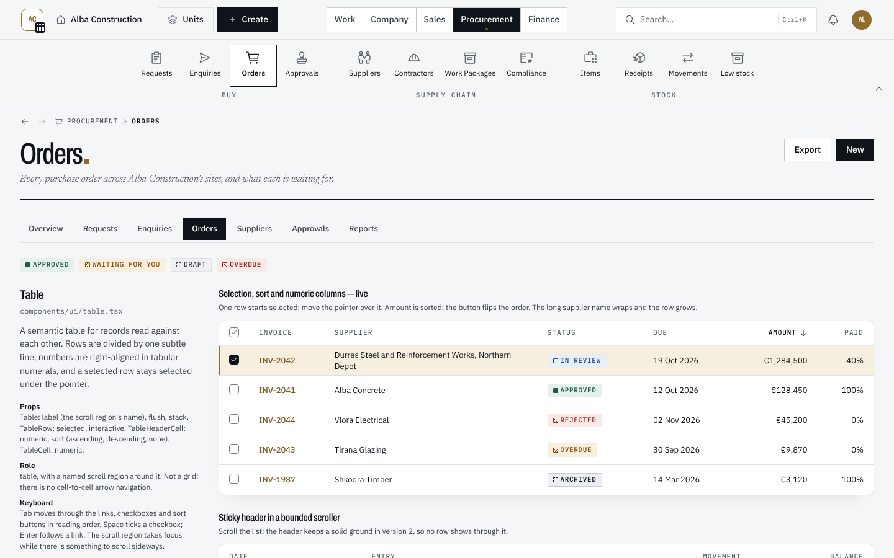
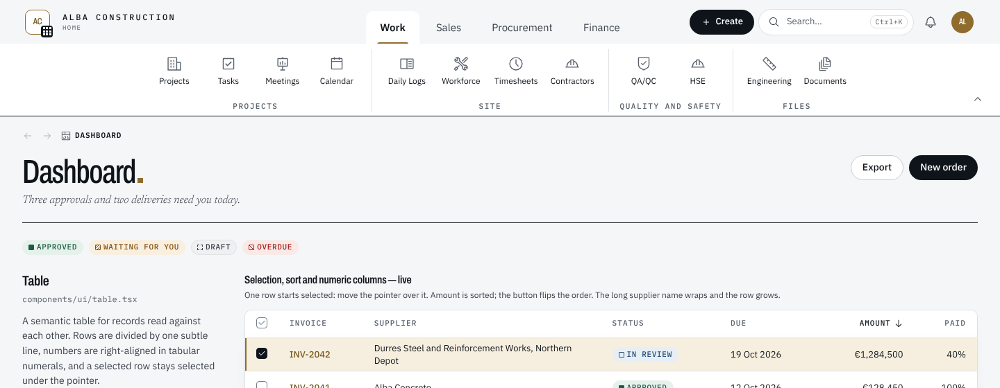
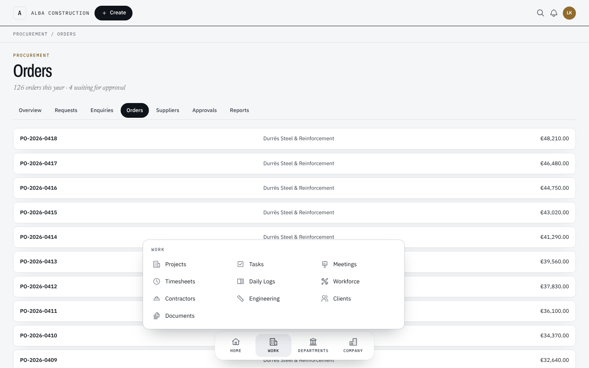
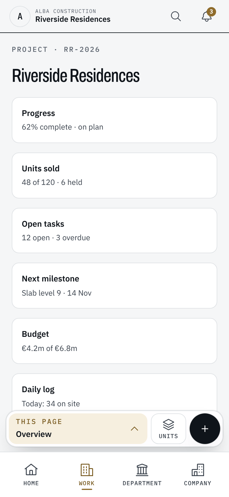
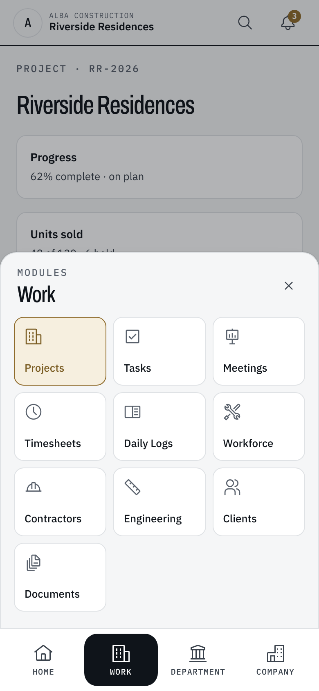
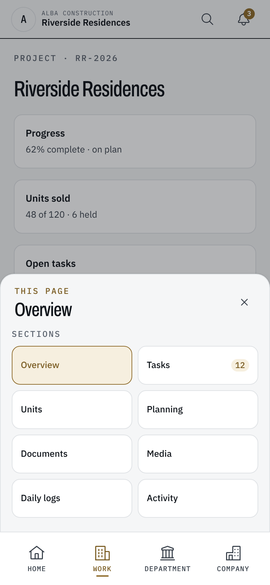
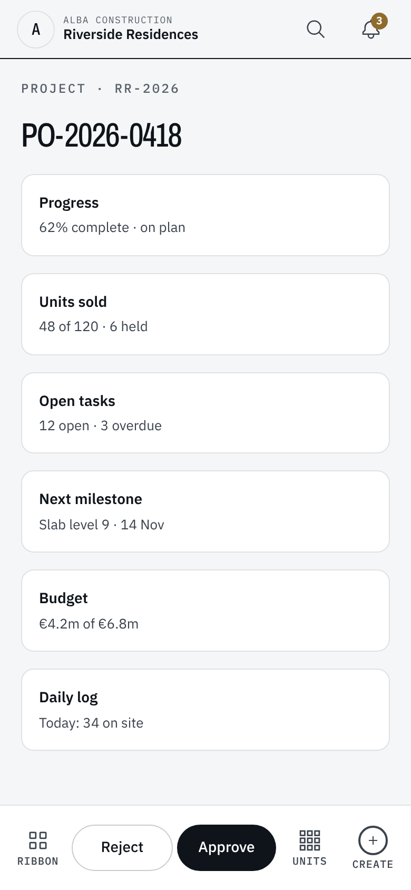
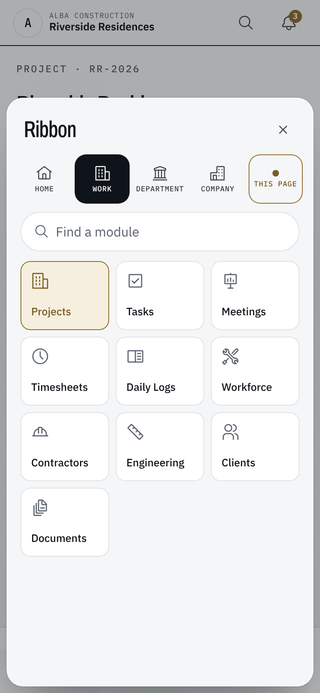

> **Chat:** Nesto UI/UX — navigation study
> **File:** docs/ui/UI-04-navigation-layouts.md
> **About:** Nesto's navigation layouts — the Ribbon and the Dock on a desktop, the Pocket Ribbon and the Action Ribbon on a phone — chosen per person in Settings › Appearance; what each draws, where the code lives, and what comes next.
> **Last updated:** 2026-11-10

# UI-04 — Navigation layouts

The navigation study (the "Nesto navigation concepts" canvas) compared four
ways to move around Nesto. The owner chose two for each kind of screen, and
each person picks one of them in **Settings › Appearance**. The phone pair
came from a second study ("Phone ideas" on the canvas): both bring the desktop
Ribbon to the phone, so a person who knows one knows the other.

| Screen | Default | The other choice |
| --- | --- | --- |
| Desktop, from `lg` (1024px) | **Ribbon** (A) | **Dock** (C) |
| Phone and tablet held upright, below `lg` | **Pocket Ribbon** | **Action Ribbon** |

The sidebar is gone. Its two jobs moved: the workspace's name and the way to
its dashboard open the top bar (`data-testid="topbar-home"`), and the modules
are in the chosen desktop navigation. A demonstration tenant's notice moved
from the sidebar's foot to the top bar.

## 1. How the choice is kept

- Two cookies, read on the server like Day and Night: `nesto.desktop-nav`
  (`ribbon` | `dock`) and `nesto.phone-nav` (`pocket` | `action`). The
  retired phone values (`thumb`, `tabs`) read as the default.
  `lib/layout/nav-layout.ts` reads them; anything else is the default.
- `app/layout.tsx` writes both onto `<html>` (`data-desktop-nav`,
  `data-phone-nav`), so CSS is right on the first paint.
- `components/layout/app-shell.tsx` draws only the chosen desktop and phone
  navigation. Both are fed by the one navigation resolver
  (`config/navigation.ts`), so a module a person may not open is in neither.
- `components/settings/navigation-preference.tsx` writes the cookie and the
  attribute, then refreshes the page from the server: the new layout appears
  at once. Each choice is a radio group of two cards with a small drawing.

## 2. Desktop — the Ribbon (default)

`components/layout/ribbon.tsx`, inside the top bar's sticky header, under its
row. `--nesto-shell-header-h` grows to cover both, so the breadcrumb bar, tab
rows and panels still pin beneath it.

- **Tabs:** Home, Work, Department, Company — the navigation groups. Each
  tab's body is that group's modules as large buttons; the module you are in
  is filled.
- **This page:** a module page adds its own tab, marked "This page" the way
  Office marks a contextual tab. Its body is the module's sections, and it is
  the tab shown by default there. The module's own section row
  (`ModuleTabs` → `ContextTabsFrame moduleRow` → `data-module-row`) registers
  as the `module` level of the section store, so the page does not draw the
  row a second time from `lg` (`styles/globals.css`).
- A record's own tabs (an invoice inside Finance) stay on the page and pin
  where the module row would have been.
- The Ribbon names the current module on itself (`data-current-module`,
  `data-current-href`, `data-current-label`) whichever tab is showing.

## 3. Desktop — the Dock

`components/layout/desktop-dock.tsx`: one tab per navigation group in a bar
floating at the foot of the window, from `lg`. Each tab opens its own menu of
that group's modules above it; the tab holding the module you are in is marked
with a gold rule. Module sections stay on the page, in their tab row. Content
keeps clear of the bar through `--nesto-bottom-nav-space`.

## 4. Phone — what both share

`components/layout/phone-ribbon.tsx`, below `lg`:

- **The same tabs as the desktop Ribbon:** Home, Work, Department, Company,
  and This page. A tab's modules are large tiles (84px, three to a row); the
  module you are in is the gold tile, and the tab holding it is gold too.
  Company always exists: it also holds you — the profile, Settings, Refresh,
  the theme and Logout.
- **This page:** the section the page is on (or the page's own name), which
  opens the page's sections as tiles — the tab rows are not drawn below `lg`.
  A record inside a tabbed page (a unit inside its project) adds a second
  group. It replaces the section pill that sat at the top right.
- **Units and Create, one tap from anywhere.** Units goes to the units of the
  project you are in, else of the last project you were in on this device
  (`nesto.last-project`), else to the projects list. Create opens Quick
  Create (`OPEN_QUICK_CREATE_EVENT`); a tablet keeps Create in its top bar.
- **The bell** is the top bar's at every width.
- Site-ready: every target is at least 56px, nothing depends on a gesture,
  and the labels are words, not only icons.
- `lib/navigation/phone.ts` holds the pure parts (which tabs, which project),
  unit-tested.

## 5. Phone — the Pocket Ribbon (default)

`components/layout/pocket-ribbon.tsx`. The bar is the four tabs, in the
thumb's reach. Above it floats the strip: **This page · Units · Create**. A
tab opens its tiles just above the bar (the strip makes way); a second tap,
the Close button, a tap on the dimmed page or Escape closes it, and focus goes
back to the tab. A page's main action keeps its own bar above the strip
(`MainAction`, `components/ui/mobile-action-bar.tsx`). Content keeps clear of
the bar and the strip through `--nesto-bottom-nav-space`, which is taller for
this layout (`html:has([data-mobile-bottom-nav="pocket"])`).

## 6. Phone — the Action Ribbon

`components/layout/action-ribbon.tsx`. One bar about doing:
**Ribbon · the page's main actions · Units · Create**. The page's main actions
(Approve, Submit…) sit in the bar itself — `MobileActionBarHost inline` — so
the next step is under the thumb; on a page without one, that place is This
page. Ribbon opens the whole Ribbon as a sheet: the tabs (This page included
where the page has sections), a field that finds a module by name, and the
tiles, opening on the tab you are in.

The screenshots come from a preview page that mounts the real components with
the full navigation and a stand-in top bar; the signed-in app needs a database
this environment does not have.

## 7. Tests

- `tests/unit/navigation/navigation-layouts.test.ts`: the defaults, the cookie
  readers, the module level in the section store, the phone tabs and the
  project Units goes to, and that the shell draws the chosen layouts and no
  sidebar.
- `tests/e2e/responsive/aud04-mob02-shell.spec.ts` covers both phone layouts;
  the other phone specs use the tabs (`phone-tab-*`), the panel
  (`phone-panel`), This page (`section-menu-trigger`), `phone-units` and
  `phone-create`.
- End-to-end: `tests/e2e/fixtures.ts` has `mainNavigation`, `navigationLink`
  (presses the group's tab first), `navigationHrefs` and `navigationNames`;
  the specs that used the sidebar now use them. The rail-collapse test is gone
  with the rail.

## 8. Next

- Record actions in the Ribbon's page tab (Approve, Send, Receive…), in three
  groups: create, process, report.
- The simplified one-line Ribbon and a status bar, from the canvas.
- A first-click test of both desktop layouts and both phone layouts with
  office and site users (gloves, sunlight, one hand).
