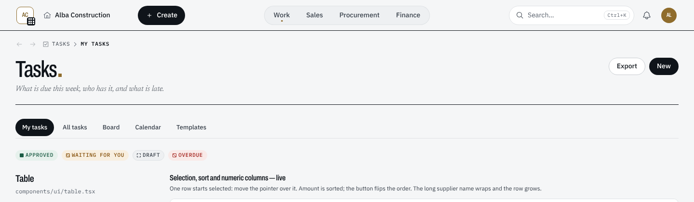
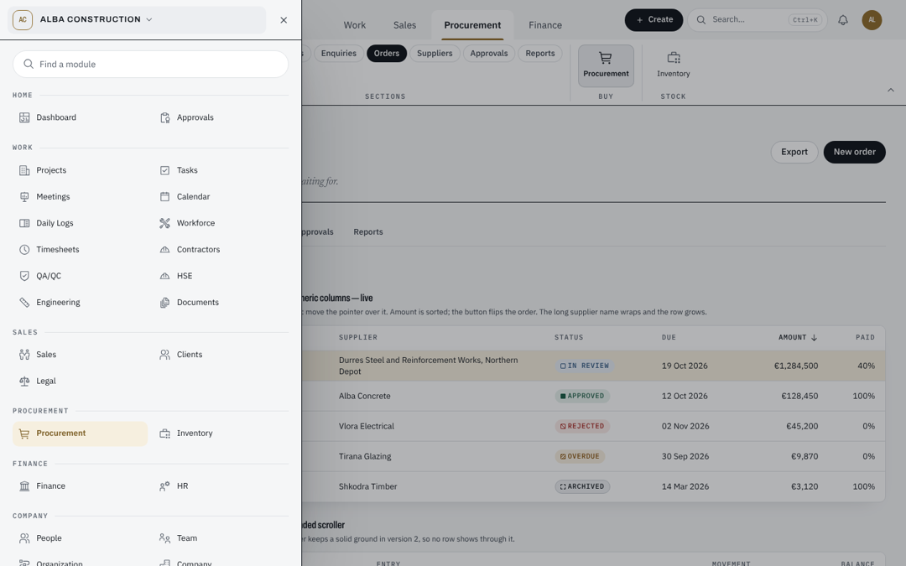
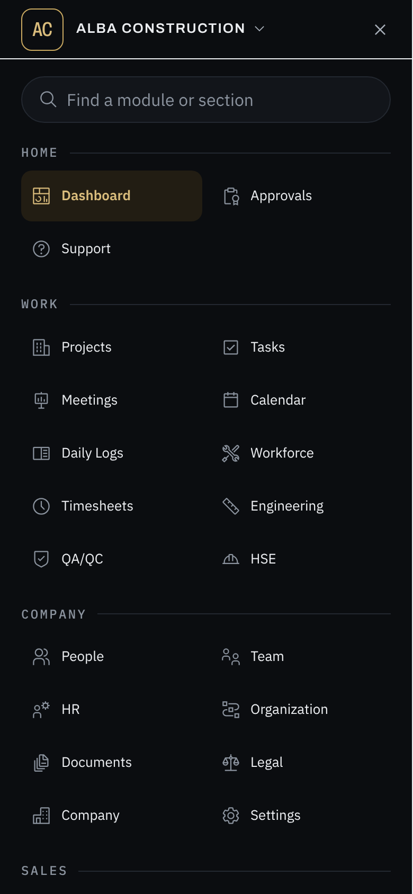

> **Chat:** Nesto UI/UX — navigation study
> **File:** docs/ui/UI-04-navigation-layouts.md
> **About:** How a person moves around Nesto — one top bar with the Ribbon's four tabs (Work, Sales, Procurement, Finance) on a desktop, the logo's panel of every module, and the Pocket Ribbon or the Action Ribbon on a phone; what each draws, where the code lives, and what comes next.
> **Last updated:** 2026-11-11 (the bar in three equal columns; sections left to the page)

# UI-04 — Navigation layouts

The navigation study ("Nesto navigation concepts", then "Platform, redrawn"
on the design canvas) ended with Concept A, Office's ribbon, reshaped by the
owner: four tabs only, in the same line as Search, centred; Home is the
company's name; the company logo opens every module in a panel on the left
third of the screen, the way Office's app launcher opens.

| Screen | Navigation |
| --- | --- |
| Desktop, from `lg` (1024px) | **One top bar** with the Ribbon's four tabs, and the open tab's ribbon under it |
| Phone and tablet held upright, below `lg` | **Pocket Ribbon** (default) or **Action Ribbon**, chosen in Settings › Appearance |

The Dock is retired, with its setting: one desktop layout. The breadcrumb bar
is gone too; its trail is now the page head's mono line.

## 1. Where every module lives

`config/navigation.ts`, `NAVIGATION_LAYOUT`: six groups, each in captioned
sets. Order there is order on screen. A unit test checks that every module in
the navigation is placed exactly once.

| Group | Sets and modules |
| --- | --- |
| **Home** (the company name, and the logo's panel) | Dashboard, Approvals |
| **Work** (tab) | Projects: Projects, Tasks, Meetings, Calendar · Site: Daily logs, Workforce, Timesheets, Contractors · Quality and safety: QA/QC, HSE · Files: Engineering, Documents |
| **Sales** (tab) | Sell: Sales, Clients · Legal: Legal (contracts) |
| **Procurement** (tab) | Buy: Procurement · Stock: Inventory |
| **Finance** (tab) | Money: Finance · People: HR |
| **Company** (the logo's panel) | People, Team, Organization, Company, Settings, Support |

Moving a module is one line in `NAVIGATION_LAYOUT`. The public site's zones
(`MODULE_GROUPS` in `config/modules.ts`) are separate and unchanged.

## 2. Desktop — the top bar

`components/layout/topbar.tsx`, sticky at the top of every page:

    [ logo · ⌂ Alba Construction ·      + Create ]   ( Work | Sales | Procurement | Finance )   [ Search…           ⌘K · bell · account ]

- **Three columns, the two sides equal.** From `lg` the row is a grid,
  `minmax(0,1fr) auto minmax(0,1fr)`, and each side is the same width
  (`--nesto-bar-side`, 22rem, narrower when the window is). Each side's content
  runs from the outer edge to the inner one — + Create on the left, the search
  field on the right — so the tabs in the middle have the same space on either
  side: 164px each at 1440px wide, 32px at 1024px.
- **One line, one size, one type.** Every control is 40px tall (44px on touch)
  and sits on the row's centre line, and every label is 14px medium with a 16px
  icon: Home, + Create, the tabs, the search field's text.
- **The left is where you are and what you make; the right is the universal
  cluster** in its order: Search, Notifications, Account (UI-01 §1).

- **The logo** (`ModulesPanel`, `components/layout/modules-panel.tsx`): the
  workspace's mark with a small grid. It opens a panel on the left third of the
  screen (at least 26rem; the whole width on a phone). The panel's header is
  the workspace, and it switches the workspace where there is somewhere else to
  work (`OrganizationWorkspaceHeader`). Then a field that finds a module, and
  every module this person may open, by group. On a phone the panel ends with
  you: the profile, Settings, Refresh, the theme and Logout.
- **Home** (`HomeLink`): a small house and the workspace's name. It goes to
  the Dashboard and switches nothing.
- **+ Create** stands at the inner edge of the left side; between `lg` and
  `xl` it is the + alone. Its menu opens under it.
- **The four tabs** are one segmented control in the middle column: the open
  tab raised on the track. The tab holding the page you are on carries the
  homepage's small gold square under its name, whichever tab is open, and with
  the ribbon folded.
- **Search** is a field-shaped button that takes what the right side leaves,
  with its shortcut from `xl`; below `lg`, an icon.

## 3. Desktop — the ribbon

`components/layout/ribbon.tsx`, inside the same sticky header. Three parts
share one state: `RibbonProvider` (around the bar's row and the panel),
`RibbonTabs` (the middle column) and `RibbonPanel` (under the bar).

- The open tab's sets, centred, each a group of large buttons with its caption
  under it, the module you are in marked.
- A module's sections are not repeated in the ribbon: they are the tabs under
  the page's title.
- **Which tab is open:** Work on the Dashboard and anywhere outside the four
  tabs; on a module page, the module's own tab. A tab picked by hand lasts
  until the next navigation.
- **Folding:** click the open tab, or the arrow at the ribbon's end, and the
  bar is alone; click any tab to open it again. Folded or open is kept in the
  `nesto.ribbon` cookie and on `<html data-ribbon>`, so the shell's height is
  right on the first paint.
- **Space:** `--nesto-shell-header-h` is the bar's row (64px) plus the ribbon
  (104px) when it is open: 168px, against 238px before (bar, ribbon tabs,
  ribbon band and breadcrumb bar). Folded, it is 64px. Tab rows and panels pin
  under it.
- The ribbon names the module you are in (`data-ribbon`,
  `data-current-module`, `data-current-href`, `data-current-label`) whichever
  tab is open.

## 4. The page head

- **The breadcrumb** is a mono line at the top of the page, above the title,
  scrolling with it, with Back and Forward before it
  (`BreadcrumbBar`, `components/ui/breadcrumbs.tsx`). It takes no height in the
  sticky stack (`--nesto-shell-breadcrumb-h: 0`). Phones carry none.
- **Titles:** a page's or a module's title is 48px from `md` and ends in the
  homepage's gold square (`[data-page-title]::after`, `styles/globals.css`).

## 5. Phone — what both share

`components/layout/phone-ribbon.tsx`, below `lg`:

- **The top bar:** the logo (the same panel, full width) and Home, then
  Search and the bell. The account is at the foot of the logo's panel.
- **The Ribbon's four tabs.** A tab's modules are large tiles (84px, three to a
  row); the module you are in is the gold tile, and the tab holding it is gold
  too. Home and Company are in the logo's panel.
- **This page:** the section the page is on (or the page's own name), which
  opens the page's sections as tiles — the tab rows are not drawn below `lg`.
- **Units and Create, one tap from anywhere,** as before.
- `lib/navigation/phone.ts` holds the pure parts (which tabs, which project),
  unit-tested.

## 6. Phone — the Pocket Ribbon (default)

`components/layout/pocket-ribbon.tsx`. The bar is the four tabs, in the
thumb's reach. Above it floats the strip: **This page · Units · Create**. A tab
opens its tiles just above the bar; a second tap, Close, a tap on the dimmed
page or Escape closes it.

## 7. Phone — the Action Ribbon

`components/layout/action-ribbon.tsx`. One bar about doing:
**Ribbon · the page's main actions · Units · Create**. Ribbon opens the whole
Ribbon as a sheet: the four tabs (This page too, where the page has sections),
a field that finds any module by name, and the tiles.

The screenshots come from a preview page that mounts the real top bar, ribbon,
panel and phone Ribbon with sample data; the signed-in app needs a database
this environment does not have.

## 8. Tests

- `tests/unit/navigation/navigation-resolver.test.ts`: every module placed
  once, the four tabs in order, each module in its tab.
- `tests/unit/navigation/navigation-layouts.test.ts`: the cookie readers, the
  phone tabs, and that the shell draws one top bar with the Ribbon, the logo's
  panel and Home, and no Dock.
- `tests/unit/a11y/theme-drift.test.ts`: the bar, ribbon and breadcrumb
  heights.
- End-to-end: `tests/e2e/fixtures.ts` reads every module from the logo's panel
  (`navigationHrefs`, `navigationNames`, `navigationLink`) and switches the
  workspace from its header (`openWorkspaceSwitcher`, `chooseWorkspace`).
  `tests/e2e/shell/organization-header.spec.ts` covers Home and the switch.
  These need the database to run.

## 9. Next

- A Create group at the start of each tab's ribbon (New task, New order…), from
  Quick Create's actions for that tab's modules.
- Recent records in the logo's panel.
- Cards as sheets and forms as title blocks, from the canvas's brief.
- A first-click test with office and site users (gloves, sunlight, one hand).
