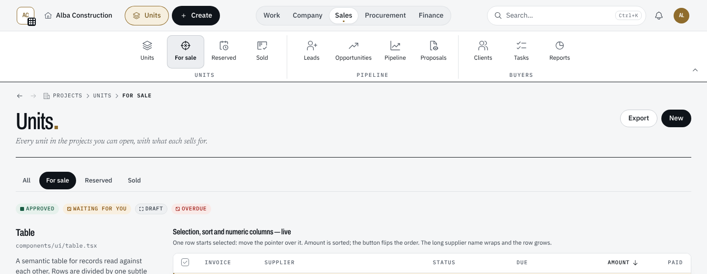
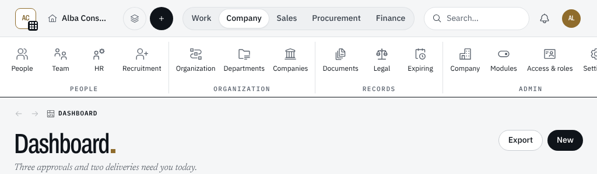
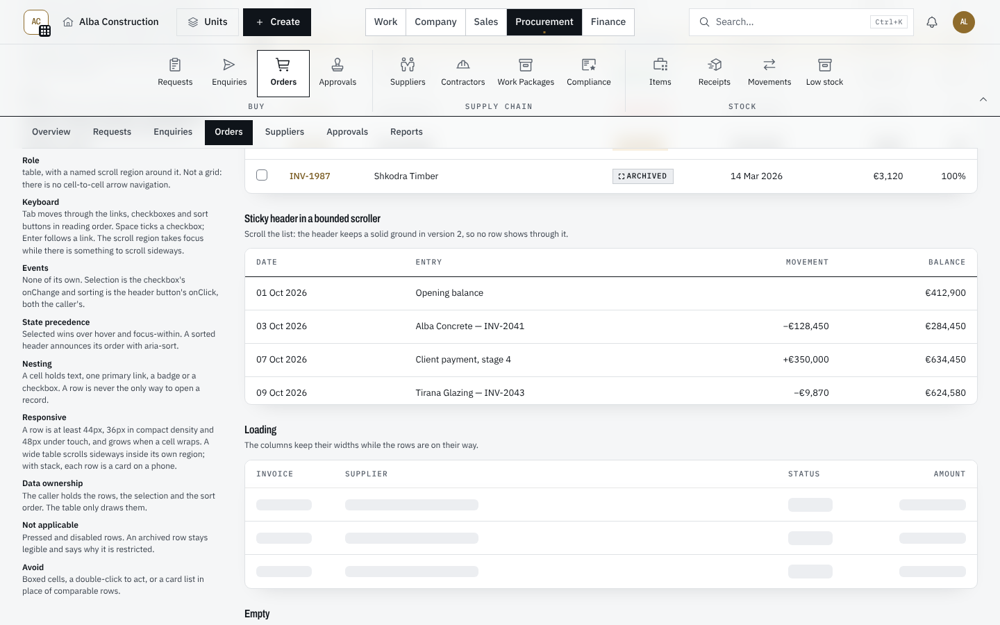
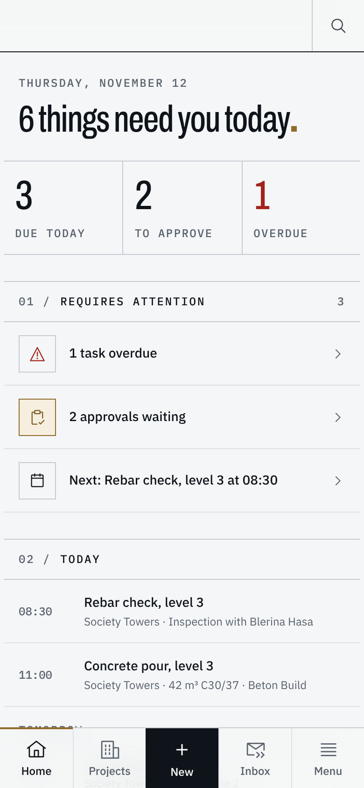
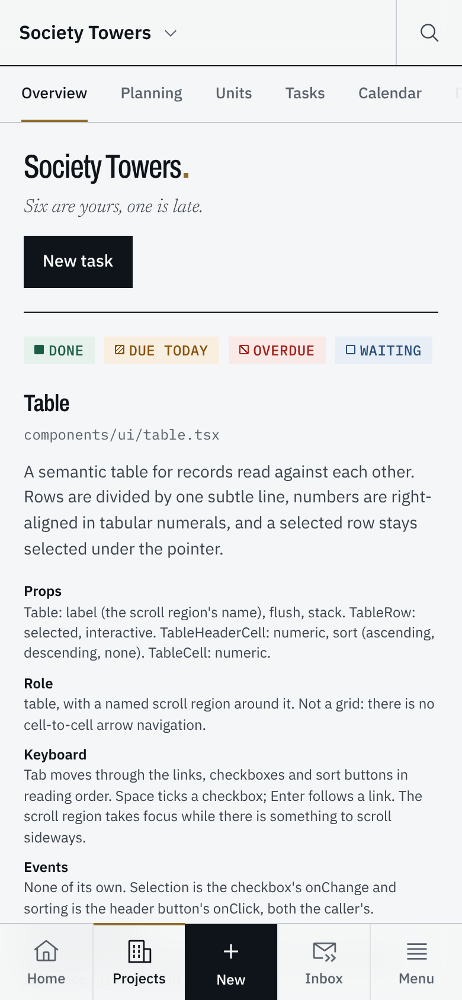
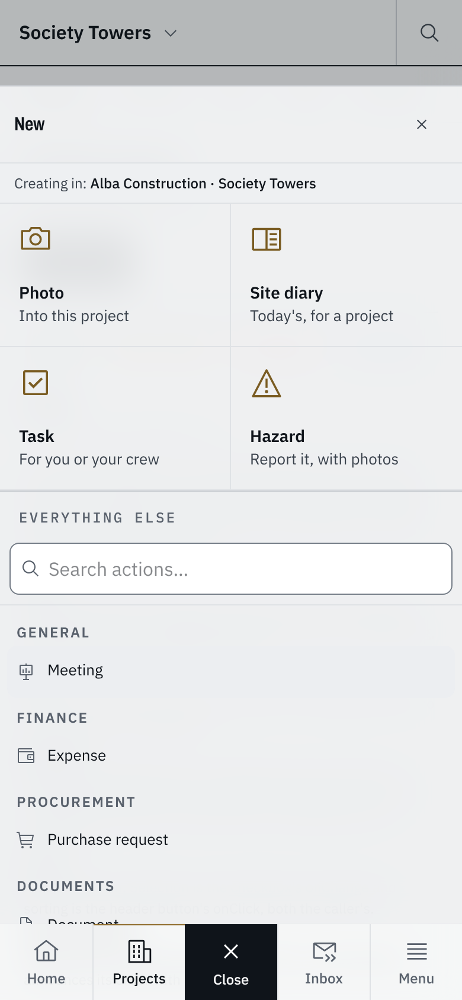
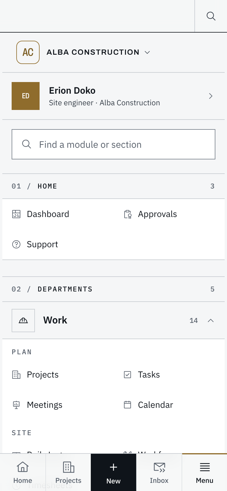
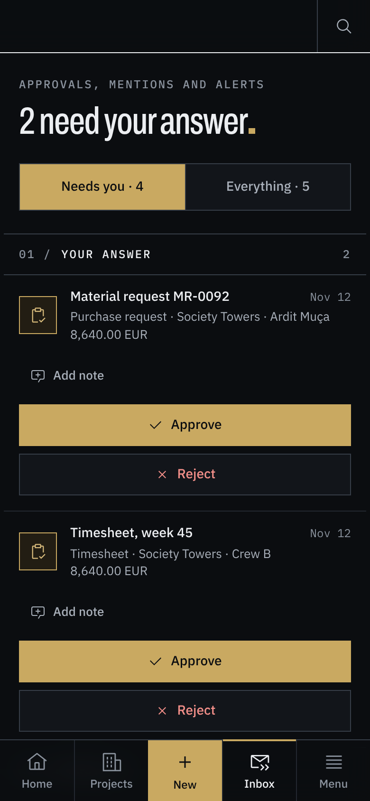

> **Chat:** Nesto UI/UX — navigation study
> **File:** docs/ui/UI-04-navigation-layouts.md
> **About:** How a person moves around Nesto — one top bar with the Ribbon's five tabs (Work, Company, Sales, Procurement, Finance) and Units pinned beside + Create on a desktop, the logo's panel of every module, and on a phone a bar of five places (Home, Projects, New, Inbox, Menu) with the page's sections in a row under the top bar; what each draws, where the code lives, and what comes next.
> **Last updated:** 2026-11-12 (the phone rebuilt for the site team: five places, the section row, Inbox and Menu)

# UI-04 — Navigation layouts

The navigation study ("Nesto navigation concepts", then "Platform, redrawn"
on the design canvas) ended with Concept A, Office's ribbon, reshaped by the
owner: a few tabs only, in the same line as Search, centred; Home is the
company's name; the company logo opens every module in a panel on the left
third of the screen, the way Office's app launcher opens. "Five tabs and
Units" on the canvas then spread the modules over five tabs and added Units.

| Screen | Navigation |
| --- | --- |
| Desktop, from `lg` (1024px) | **One top bar** with the Ribbon's five tabs, and the open tab's ribbon under it |
| Phone and tablet held upright, below `lg` | **The bar of five places** — Home · Projects · New · Inbox · Menu — one layout for everyone |

The Dock is retired, with its setting: one desktop layout. The breadcrumb bar
is gone too; its trail is now the page head's mono line.

## 1. Where every module lives

`config/navigation.ts` holds two layouts, both read by the one resolver
(`resolveNavigation`, which returns `{ menu, ribbon }`). Order there is order on
screen.

- **`MENU`, the logo's panel:** every module exactly once, by group. A unit
  test checks it.
- **`RIBBON`, the five tabs:** each tab in captioned sets of three or four
  buttons. A button opens a module, or one of its sections (Orders, Drawings,
  Leads), so a big module spreads over several buttons and no tab is a list
  of one or two. A section button needs the module's permission and the
  section's own, exactly as the section's tab under the page title does.

| Tab | Sets and buttons |
| --- | --- |
| **Work** — the project, day to day; opens first | Plan: Projects, Tasks, Meetings, Calendar · Site: Daily logs, Workforce, Timesheets · Design: Drawings, RFIs, Submittals · Quality and safety: QA/QC, Defects, HSE, Incidents |
| **Company** — the company, across projects | People: People, Team, HR, Recruitment · Organization: Organization, Departments, Companies · Records: Documents, Legal, Expiring · Admin: Company, Modules, Access & roles, Settings |
| **Sales** — the units, and who buys them | Units: Units, For sale, Reserved, Sold · Pipeline: Leads, Opportunities, Pipeline, Proposals · Buyers: Clients, Tasks, Reports |
| **Procurement** — buying, subcontracting, stock | Buy: Requests, Enquiries, Orders, Approvals · Supply chain: Suppliers, Contractors, Work packages, Compliance · Stock: Items, Receipts, Movements, Low stock |
| **Finance** — money and control | Money: Finance, Invoices, Payments, Expenses · Control: Budgets, Commitments, Approvals, Reports |

The logo's panel: **Home** (Dashboard, Approvals, Support), then the same five
groups with their modules — Units, Sales and Clients under Sales; Legal (the
Contracts module) and HR under Company.

Labels in `config/navigation.ts` are English; the server puts each in the
reader's language (`lib/workspace/navigation.ts`: a module by its name, a
section as its tab is named, Units from `shell.nav`). Moving a button is one
line. The public site's zones (`MODULE_GROUPS` in `config/modules.ts`) are
separate and unchanged.

### Why this spread

- **Microsoft's ribbon guidance:** a handful of tabs (never more than seven),
  each in groups of a few commands; no group of one or two. Every set here has
  three or four, and a unit test holds it to that.
  ([Ribbons, Windows UX guidelines](https://learn.microsoft.com/en-us/windows/win32/uxguide/cmd-ribbons))
- **Procore** splits company-level tools from project-level ones; Work is the
  project, Company is what runs across projects.
  ([Procore: project tools and company tools](https://support.procore.com/faq/what-settings-are-available-for-project-tools-in-procore))
- **NN/g:** group by the reader's mental model, not the org chart, and show
  each option once. ([Card sorting](https://www.nngroup.com/articles/card-sorting-definition/), [Mental models](https://www.nngroup.com/articles/mental-models/))
- **SAP Fiori spaces and pages**, **Business Central role centres:** the next
  step, one layout per role (below, §9).
  ([Fiori launchpad spaces](https://www.sap.com/design-system/fiori-design-web/v1-139/foundations/integration-and-services/sap-fiori-launchpad/sap-fiori-launchpad-spaces), [Designing role centers](https://learn.microsoft.com/en-us/dynamics365/business-central/dev-itpro/developer/devenv-designing-role-centers))
- **Real-estate developer ERPs** put the unit inventory at the centre, which is
  why Units is pinned in the bar and leads the Sales tab.

## 2. Desktop — the top bar

`components/layout/topbar.tsx`, sticky at the top of every page:

    [ logo · ⌂ Alba Construction ·   Units · + Create ]   ( Work | Company | Sales | Procurement | Finance )   [ Search…     ⌘K · bell · account ]

- **Three columns, the two sides equal.** From `lg` the row is a grid,
  `minmax(0,1fr) auto minmax(0,1fr)`, and each side is the same width
  (`--nesto-bar-side`, 26rem, narrower when the window is). Each side's content
  runs from the outer edge to the inner one — Units and + Create on the left,
  the search field on the right — so the tabs in the middle have the same space
  on either side.
- **One line, one size, one type.** Every control is 40px tall (44px on touch)
  and sits on the row's centre line, and every label is 14px medium with a 16px
  icon: Home, Units, + Create, the tabs, the search field's text.
- **The left is where you are and what you make; the right is the universal
  cluster** in its order: Search, Notifications, Account (UI-01 §1).
- **Glass and square** (UI-05 §9). The bar and the open ribbon are glass: 82%
  of the page and a 14px blur, on a layer behind the header (a backdrop
  filter on the header itself would trap the phone's + Create sheet), so the
  page blurs as it scrolls under them. Every control is square with a line:
  Home, Units, + Create, the search field, the bell, the five tabs (the open
  one in ink), the ribbon's buttons (the one you are in outlined in ink), the
  tab rows under page titles and the phone's tiles and bar. Labels stay 14px
  in sentence case — mono capitals are the site's.

- **The logo** (`ModulesPanel`, `components/layout/modules-panel.tsx`): the
  workspace's mark with a small grid. It opens a panel on the left third of the
  screen (at least 26rem; the whole width on a phone). The panel's header is
  the workspace, and it switches the workspace where there is somewhere else to
  work (`OrganizationWorkspaceHeader`). Then a field that finds a module or a
  section by name, and every module this person may open, by group. On a phone
  the panel ends with you: the profile, Settings, Refresh, the theme and
  Logout.
- **Home** (`HomeLink`): a small house and the workspace's name. It goes to
  the Dashboard and switches nothing.
- **Units** (`RibbonUnits`, `components/layout/ribbon.tsx`): pinned beside
  + Create for every role that may see units. Inside a project it opens that
  project's units; anywhere else, every unit across the projects (§4). Gold
  while you are there. Below 1440px it is the icon alone.
- **+ Create** stands at the inner edge of the left side; between `lg` and
  `xl` it is the + alone. Its menu opens under it.
- **The five tabs** are one segmented control in the middle column: the open
  tab raised on the track. The tab holding the page you are on carries the
  homepage's small gold square under its name, whichever tab is open, and with
  the ribbon folded.
- **Search** is a field-shaped button that takes what the right side leaves,
  with its shortcut from `xl`; below `lg`, an icon.

## 3. Desktop — the ribbon

`components/layout/ribbon.tsx`, inside the same sticky header. Three parts
share one state: `RibbonProvider` (around the bar's row and the panel),
`RibbonTabs` (the middle column) and `RibbonPanel` (under the bar).

- The open tab's sets, centred, each a group of large buttons with its caption
  under it. The button the page is under is marked: the longest route wins, so
  `/procurement/orders/12` marks Orders, and `/projects/units/sold` marks Sold.
- **Which tab is open:** Work on the Dashboard and anywhere outside the five
  tabs; on a page, the tab holding its button (Units is Sales, though it lives
  under Projects). A tab picked by hand lasts until the next navigation.
- **Folding:** click the open tab, or (from 1440px) the arrow at the ribbon's
  end, and the bar is alone; click any tab to open it again. Folded or open is
  kept in the `nesto.ribbon` cookie and on `<html data-ribbon>`, so the shell's
  height is right on the first paint.
- **Room:** from 1440px the sets have wide buttons and the fold arrow. Below
  it the buttons and gaps tighten and the arrow goes, so every tab fits from
  1280px; at 1024px the Company tab scrolls sideways by a button.
- **Space:** `--nesto-shell-header-h` is the bar's row (64px) plus the ribbon
  (104px) when it is open: 168px. Folded, it is 64px. Tab rows and panels pin
  under it.
- The ribbon names the panel entry the page is under (`data-ribbon`,
  `data-current-module`, `data-current-href`, `data-current-label`) whichever
  tab is open.

## 4. Units

`/projects/units` (`components/projects/units-overview.tsx`,
`lib/modules/project-structure/units-overview.service.ts`): every unit this
person may see, across the projects, by project, building and floor, 50 to a
page, with a search by unit, project or type. A row opens the unit in its
project.

- **No new module.** Units rides on Projects: the Projects switch, and
  `project.view` with `project.structure.view`. The units are read through the
  projects' own door (`readableUnitWhere`), so an architect sees the units of
  the projects they are on, and no others. Archived units are left out.
- **Sales only to sales.** Status, price and buyer show only to a reader with
  `project.unit.sales.view`, and only they get the views — All, For sale,
  Reserved, Sold, each with its count — as the page's tabs
  (`/projects/units/for-sale` and so on). The buyer is named only to a reader
  who may open clients.
- On a workspace switch `/projects/units` is a list, not a project
  (`config/workspace-routes.ts`).

## 5. The page head

- **The breadcrumb** is a mono line at the top of the page, above the title,
  scrolling with it, with Back and Forward before it
  (`BreadcrumbBar`, `components/ui/breadcrumbs.tsx`). It takes no height in the
  sticky stack (`--nesto-shell-breadcrumb-h: 0`). Phones carry none.
- **Titles:** a page's or a module's title is 48px from `md` and ends in the
  homepage's gold square (`[data-page-title]::after`, `styles/globals.css`).

## 6. Phone

Built for the site team first — one hand, gloves, sunlight — from the canvas
"Phone, for the site team". One layout for everyone; nothing to choose in
Settings. Below `lg`:

### The bar: places, not actions

`components/layout/phone-bar.tsx`. Five equal cells at the bottom, 64px,
glass like the top bar, the place you are in marked by a 2px gold line on top:

| Cell | Opens | Marked on |
| --- | --- | --- |
| **Home** | `/my-day` — your day: what is next, what is late, what waits for you | My Day and the Dashboard |
| **Projects** | the project you were last in, in this workspace, on this device; the list before any | every page under `/projects` |
| **New** | Quick Create as a sheet standing on the bar, the field's four first — Photo, Site diary, Task, Hazard — then everything else; it reads Close while open | — (an action, drawn in ink) |
| **Inbox** | `/inbox` — approvals answered in their row, then alerts; two filters, visible. Carries the bell's count | Inbox, Approvals, Activity, Notifications |
| **Menu** | `/menu` — the workspace switch, you, a field that finds any module, Home's modules and the five departments, then Settings, Refresh, Day or Night, Help and Sign out | every other page |

- `lib/navigation/phone.ts` holds the pure parts — which place a path belongs
  to, which pages are a place's first, where Projects goes — unit-tested.
- The bar folds to its icons, 48px, while the page scrolls down and opens again
  as soon as it scrolls up. Folded, each cell keeps its name for a screen
  reader.
- Content keeps clear of it by `--nesto-bottom-nav-space`
  (`styles/globals.css`), so no page pads itself. It steps aside for the
  keyboard and for a page's own bottom bar.
- A person who may create nothing gets four cells and no New.

### The top bar: where you are, and search

`components/layout/phone-title.tsx`. 56px: the page's own name — inside a
project the project's, which drops your other projects from the bar (the
project layout's own switcher, so only projects this person may open) — and
search in a cell of its own. **Back** stands at the start on any page deeper
than a place's first page; on those, the bar is the way out. No logo, no
bell (Inbox carries it), no account (it is in Menu), no Units (Units is a
module in Menu, and a section of each project).

### The page's sections: a row under the title

`components/layout/phone-sections.tsx`. The sections the page's own tab rows
register (`components/navigation/section-registry.tsx`) — from `lg` those rows
are drawn in the page; below it, this row is, pinned under the top bar as you
scroll, glass at 60%, the one you are on underlined in gold. Visible, not in a
menu: the last one is cut by the edge, so you can see there are more. Inside a
record that has its own sections (a unit inside its project), the row is the
record's, with the way back to the section it sits in at its start.

### On the page

- **The main action** sits beside the page's title (`MainAction`,
  `components/ui/mobile-action-bar.tsx`); nothing floats over the bar.
- **A form's Save and Cancel** are its last row, each taking its share of the
  row, 48px tall (`MobileActionBar`).
- **Tables** pin their header and first column (`components/ui/table.tsx`).
- **Status** is an icon and a word, never colour alone.
- Targets are 48px.

The screenshots come from a preview page that mounts the real top bar, section
row, bar, Menu, Inbox and My Day with sample data; the signed-in app needs a
database this environment does not have.

## 7. Tests

- `tests/unit/navigation/navigation-resolver.test.ts`: every module placed
  once in the panel, the five tabs in order, three or four buttons in every
  set, each module's buttons in its own tab (Units in Sales), sections at
  their routes and behind their permissions, the tab each page opens, and the
  search.
- `tests/unit/navigation/navigation-layouts.test.ts`: the cookie reader, the
  phone's places and where Projects goes, that `/projects/units` is not a
  project, and that the shell draws one top bar with the Ribbon, Units, the
  logo's panel and Home, and no Dock.
- `tests/unit/ux/aud05-navigation.test.ts`: every button of the Ribbon and the
  panel has a page, and no group is ever empty.
- `tests/unit/a11y/theme-drift.test.ts`: the bar, ribbon and breadcrumb
  heights.
- End-to-end: `tests/e2e/fixtures.ts` reads every module from the logo's panel
  (`navigationHrefs`, `navigationNames`, `navigationLink`) and switches the
  workspace from its header (`openWorkspaceSwitcher`, `chooseWorkspace`) —
  below `lg` from Menu, and a page's sections from the section row
  (`openSection`, `currentSection`).
  `tests/e2e/shell/organization-header.spec.ts` covers Home and the switch;
  `tests/e2e/responsive/aud04-mob02-shell.spec.ts` the phone: the five places,
  Projects remembering, the project switch, the section row, Back, New, Inbox,
  Menu, the bar folding and the keyboard. These need the database to run.

## 8. Next

- **One layout per role** — an architect's Ribbon, an engineer's — as Fiori's
  spaces and Business Central's role centres do: the same buttons, chosen and
  ordered for the role, still filtered by permission.
- A Create group at the start of each tab's ribbon (New task, New order…), from
  Quick Create's actions for that tab's modules.
- Recent records in the logo's panel.
- Cards as sheets and forms as title blocks, from the canvas's brief.
- A first-click test with office and site users (gloves, sunlight, one hand).
