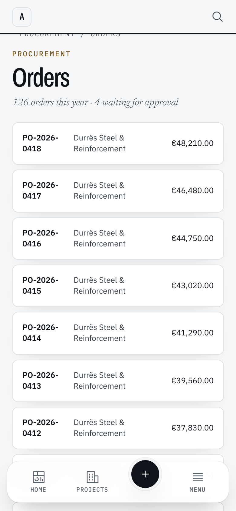
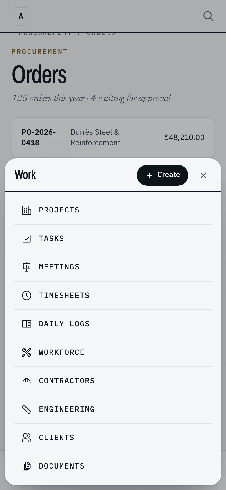

> **Chat:** Nesto UI/UX — navigation study
> **File:** docs/ui/UI-04-navigation-layouts.md
> **About:** Nesto's navigation layouts — the Ribbon and the Dock on a desktop, the Thumb bar and Bottom tabs on a phone — chosen per person in Settings › Appearance; what each draws, where the code lives, and what comes next.
> **Last updated:** 2026-11-10

# UI-04 — Navigation layouts

The navigation study (the "Nesto navigation concepts" canvas) compared four
ways to move around Nesto. The owner chose two for each kind of screen, and
each person picks one of them in **Settings › Appearance**:

| Screen | Default | The other choice |
| --- | --- | --- |
| Desktop, from `lg` (1024px) | **Ribbon** (A) | **Dock** (C) |
| Phone and tablet held upright, below `lg` | **Thumb bar** (D) | **Bottom tabs** (C) |

The sidebar is gone. Its two jobs moved: the workspace's name and the way to
its dashboard open the top bar (`data-testid="topbar-home"`), and the modules
are in the chosen desktop navigation. A demonstration tenant's notice moved
from the sidebar's foot to the top bar.

## 1. How the choice is kept

- Two cookies, read on the server like Day and Night: `nesto.desktop-nav`
  (`ribbon` | `dock`) and `nesto.phone-nav` (`thumb` | `tabs`).
  `lib/layout/nav-layout.ts` reads them; anything else is the default.
- `app/layout.tsx` writes both onto `<html>` (`data-desktop-nav`,
  `data-phone-nav`), so CSS is right on the first paint.
- `components/layout/app-shell.tsx` draws only the chosen desktop and phone
  navigation. Both are fed by the one navigation resolver
  (`config/navigation.ts`), so a module a person may not open is in neither.
- `components/settings/navigation-preference.tsx` writes the cookie and the
  attribute, then refreshes the page from the server: the new layout appears
  at once. Each choice is a radio group of two cards with a small drawing.

## 2. Desktop — the Ribbon (default)

`components/layout/ribbon.tsx`, inside the top bar's sticky header, under its
row. `--nesto-shell-header-h` grows to cover both, so the breadcrumb bar, tab
rows and panels still pin beneath it.

- **Tabs:** Home, Work, Department, Company — the navigation groups. Each
  tab's body is that group's modules as large buttons; the module you are in
  is filled.
- **This page:** a module page adds its own tab, marked "This page" the way
  Office marks a contextual tab. Its body is the module's sections, and it is
  the tab shown by default there. The module's own section row
  (`ModuleTabs` → `ContextTabsFrame moduleRow` → `data-module-row`) registers
  as the `module` level of the section store, so the page does not draw the
  row a second time from `lg` (`styles/globals.css`).
- A record's own tabs (an invoice inside Finance) stay on the page and pin
  where the module row would have been.
- The Ribbon names the current module on itself (`data-current-module`,
  `data-current-href`, `data-current-label`) whichever tab is showing.

## 3. Desktop — the Dock

`components/layout/desktop-dock.tsx`: one tab per navigation group in a bar
floating at the foot of the window, from `lg`. Each tab opens its own menu of
that group's modules above it; the tab holding the module you are in is marked
with a gold rule. Module sections stay on the page, in their tab row. Content
keeps clear of the bar through `--nesto-bottom-nav-space`.

## 4. Phone — the Thumb bar (default)

`components/layout/mobile-bottom-nav.tsx`, unchanged: Home, Projects, Create,
Alerts and Menu, with the More sheet.

## 5. Phone — Bottom tabs

`components/layout/mobile-tabs-nav.tsx`, built from the Thumb bar's own cells
and More sheet: Home (straight home), Work and Departments (each opens its own
menu from the bottom, Create at its top), Alerts (the bell) and More (the
profile, the general and company modules, Settings, Refresh, the theme and
Logout). Anything that asks for More (`OPEN_MORE_EVENT`) gets this layout's
More.

The screenshots come from a preview page that mounts the real components with
the full navigation and a stand-in top bar; the signed-in app needs a database
this environment does not have.

## 6. Tests

- `tests/unit/navigation/navigation-layouts.test.ts`: the defaults, the cookie
  readers, the module level in the section store, and that the shell draws the
  chosen layouts and no sidebar.
- End-to-end: `tests/e2e/fixtures.ts` has `mainNavigation`, `navigationLink`
  (presses the group's tab first), `navigationHrefs` and `navigationNames`;
  the specs that used the sidebar now use them. The rail-collapse test is gone
  with the rail.

## 7. Next

- Record actions in the Ribbon's page tab (Approve, Send, Receive…), in three
  groups: create, process, report.
- The simplified one-line Ribbon and a status bar, from the canvas.
- A first-click test of both desktop layouts with office and site users.
