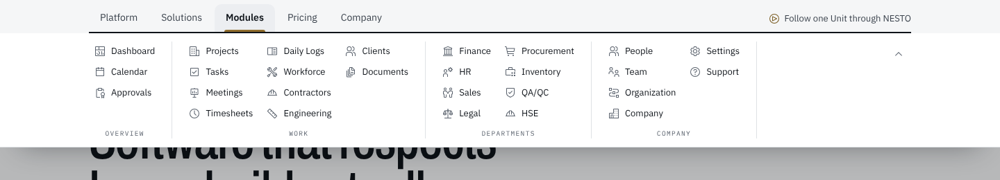
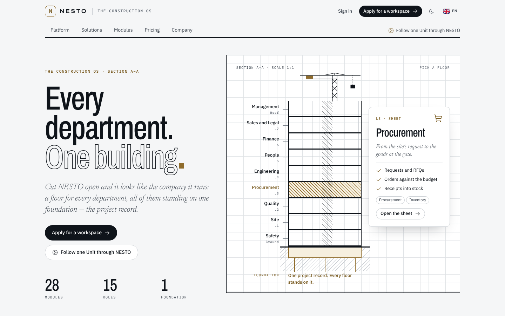
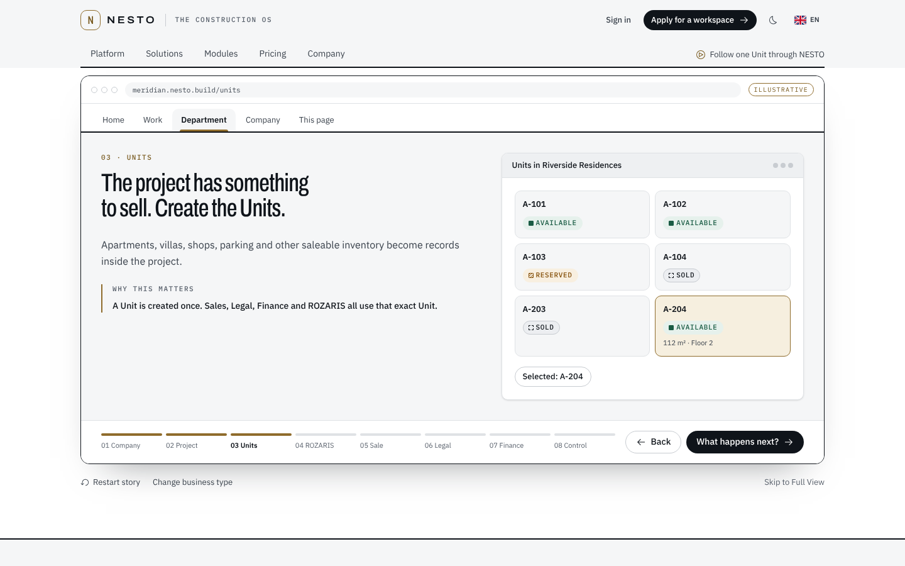
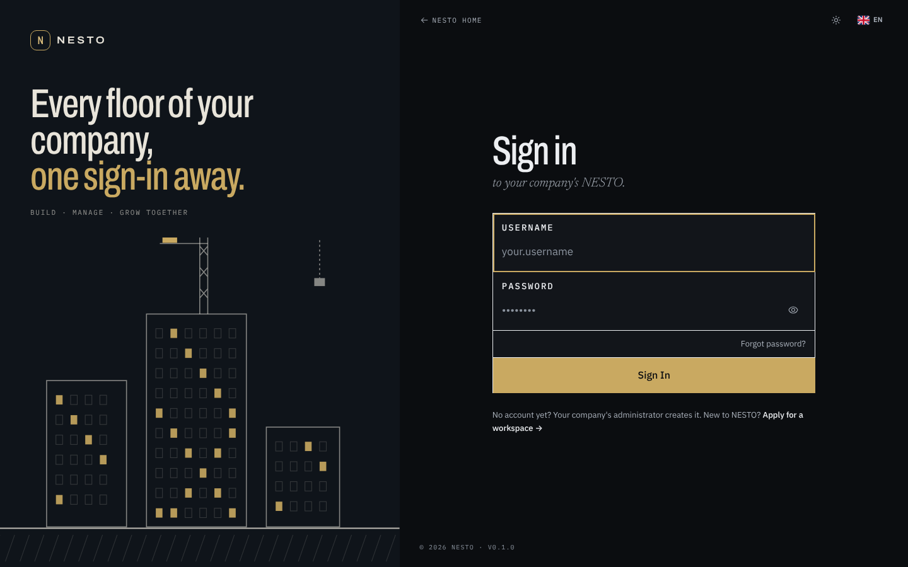
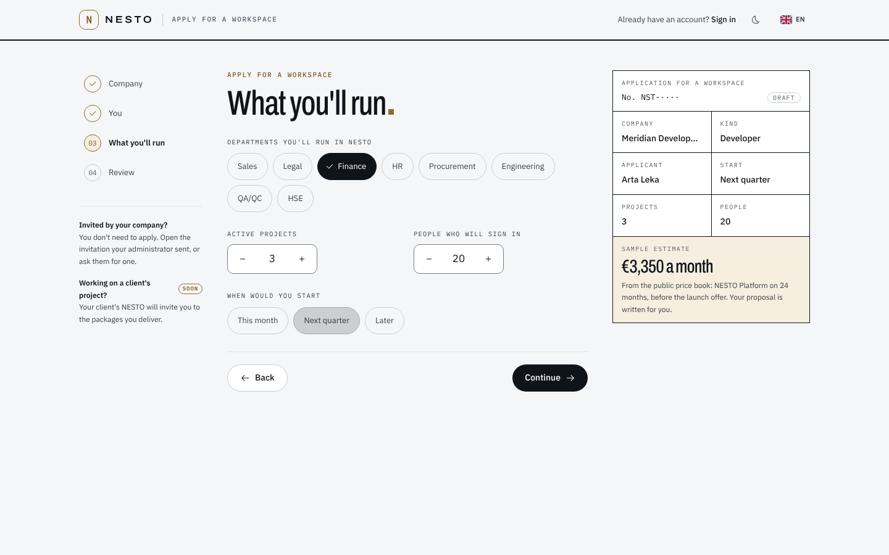
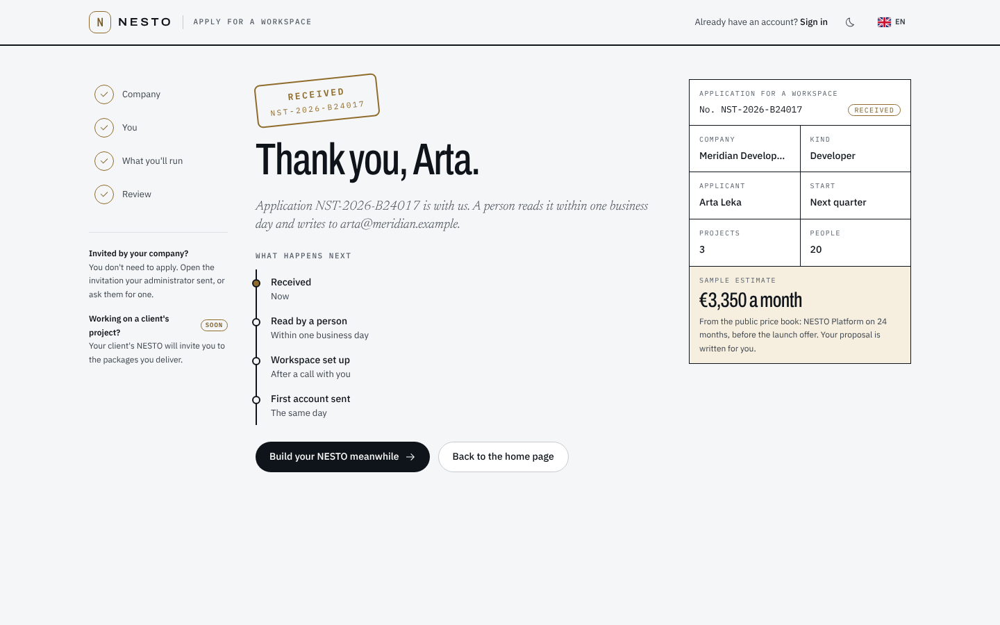
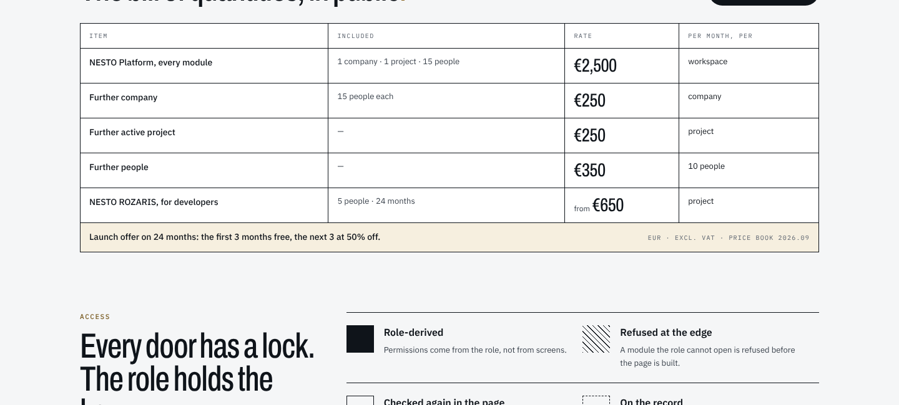
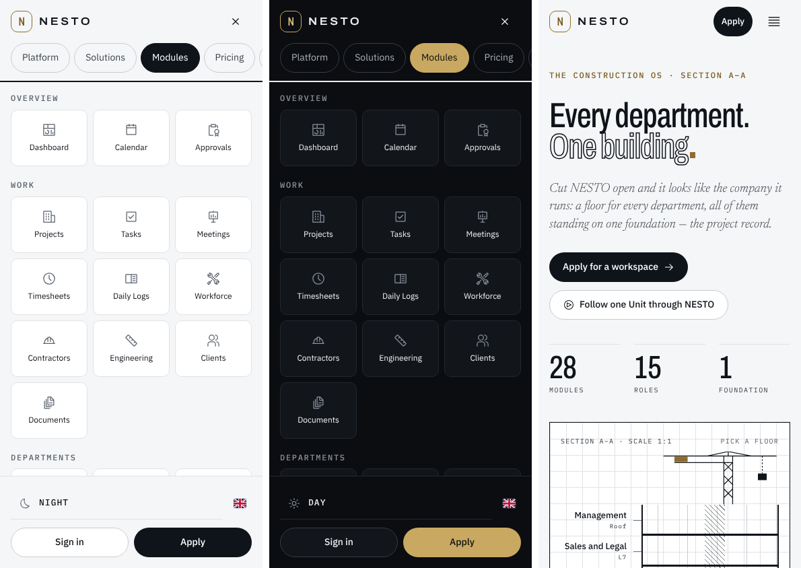
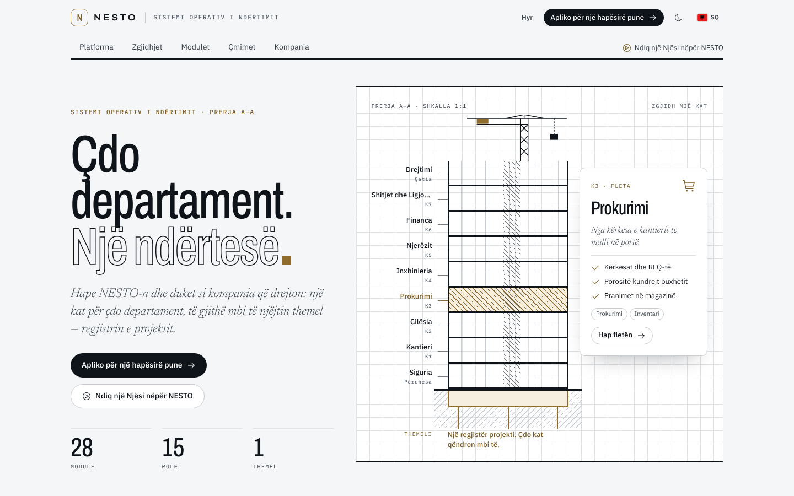

> **Chat:** Nesto UI/UX — navigation study
> **File:** docs/ui/UI-05-public-site.md
> **About:** Nesto's public site as built from the canvas: the Ribbon masthead, the section-cut homepage with "Try it here", sign in, Apply for a workspace, pricing in public and the restyled interior pages — what each draws, where the code lives, and what is still to do.
> **Last updated:** 2026-11-10

# UI-05 — The public site

The public site was redesigned on the canvas ("Public site" page) and is now
built from it. The owner's choices:

- **Masthead:** Theme 1, the Ribbon — the same idea as the app's own Ribbon.
- **Homepage:** concept C, "The section cut", with enough of concept B's
  "Try it here" window in between to let a visitor run a company through NESTO.
- **Sign up:** there is no self-service sign-up — a company's workspace is set
  up by NESTO — so "sign up" is **Apply for a workspace** (`/apply`).
- Sign in, Pricing, Security, Terms, Privacy, About, Contact, Questions,
  Platform and the Full View all move to the same drawing-set look.

Everything is in English and Albanian, in Day and Night, on desktop and phone.

## 1. The look in one paragraph

A drawing set, not a brochure. Ink rules (2px, `border-fg`) close every
masthead and page head. Display type is Archivo condensed; a heading ends on a
gold square instead of its full stop (`Dotted` in
`components/marketing/section.tsx`). Standfirsts are the serif italic.
Drawn pieces — drafting paper, hatched fills, the title block, the section
cut's slabs, outline lettering, the received stamp — are a handful of classes
in `styles/globals.css` under "The public site's drawn pieces"; everything else
is Tailwind on the product's own tokens.

## 2. The Ribbon masthead

`components/marketing/site-masthead.tsx`, mounted by
`app/(public)/(site)/layout.tsx`.

- **Top row:** logo, "The Construction OS", Sign in, **Apply for a workspace**,
  Day/Night, language.
- **Tabs:** Platform, Solutions, Modules, Pricing, Company. Each is a
  disclosure button; its panel opens full width under the ink rule with
  groups (big buttons above, a mono caption below) and, on three tabs, a dark
  callout. Escape, the scrim, a link or a new page closes it. The tab for the
  current page is marked.
- **Structure** lives in `config/marketing.ts → siteRibbon`; words in the site
  copy under `ribbon`. The **Modules** tab is the module registry
  (`config/modules.ts`), named through the `modules` dictionary, so it can
  never list a module that does not exist. The "By role" group names roles
  through the `roles` dictionary; the role count is the registry's.
- **No prices in the masthead.** The layout renders on every page and must not
  read the database; the Pricing tab links to the live rates instead.

### 2.3 On a phone

Logo, a short "Apply", and a menu button that opens a full-screen sheet — the
tabs as scrolling pills, each panel as 3-across tiles, theme and language, and
Sign in / Apply pinned at the foot.

### 2.4 Footer

The sitemap, closed by a title-block strip (©, category, sign-off, version).
"Request access" became "Apply for a workspace" → `/apply`.

## 3. The homepage

`app/(public)/(site)/page.tsx`, top to bottom.

### 3.1 The section cut

`components/marketing/home/section-cut.tsx` — NESTO drawn as a building: a
floor per department on one foundation, the project record. Each floor is a
toggle; the picked floor's sheet (line, three points, its modules) opens
beside the drawing. Floors and their modules are
`config/marketing.ts → sectionFloors`; words under `home.cut`.

### 3.2 Try it here

`components/marketing/landing/interactive-story.tsx` — the existing
interactive story, now inside an illustrative NESTO window: an address bar
(`meridian.nesto.build/units`), the app's Ribbon tabs with the slide's tab
marked, the slide, and the step bar. All the story's behaviour is kept:
shareable `/?story=…&step=…` links (which now scroll to the window), browser
Back through slides, arrow keys, the demos. A link to a slide from anywhere —
the masthead, the hero, the three kinds — re-mounts the story at that slide.

### 3.3 From the tender to the final account

The six lifecycle stages, each with a small building that rises as the
project does.

### 3.4 Three kinds of company

Developer, Contractor, Group; each opens its story.

### 3.5 The bill of quantities, in public

`lib/marketing/price-book.ts` turns the live price book
(`getPublicPricingConfig`) into rows: the Platform with what it includes, a
further company, project and people pack, and ROZARIS from its smallest class.
The launch offer is read from the active promotion. `PriceBook`
(`components/marketing/price-book.tsx`) draws them as a schedule.

**No figure is written into a page.** With no price book the schedule says so
and shows nothing. Euros are formatted with `numberText`, as the configurator
does, because Chrome has no Albanian number data and `Intl` would disagree
between server and browser.

### 3.6 Access

Four legend fills: role-derived, refused at the edge, checked again in the
page, on the record.

### 3.7 Break ground on your NESTO

The ink band: Apply, Sign in.

## 4. Interior pages

The shared primitives carry the new look to every page at once:

- `PageIntro` — mono sheet name, a large title ending on the gold square, the
  serif standfirst, an ink rule.
- `SectionHeader` — with a step number it is a sheet head: the number in
  outline, the title, a full ink rule.
- `CtaBand` — the ink band; its primary is Apply for a workspace.
- `LegalDocument` (Terms, Privacy) — a dashed "not the contract" note,
  outline section numbers.
- Pricing and Security get more than the primitives — §7.
- `Container` is 1280px wide with the masthead's gutter, so every page lines
  up with the masthead.

The Full View keeps its own opening; its words moved from `home` to `tour` in
the site copy.

## 5. Sign in

`components/layout/focused-page.tsx` and `components/layout/brand-panel.tsx`,
shared by sign in, recovery, reset, recovery-email confirmation and the
invitation.

- The brand panel is **dusk**: three towers lit floor by floor with a crane on
  the tallest (`components/layout/brand-skyline.tsx`), ink in both themes.
  "Every floor of your company, / one sign-in away." On a phone it shrinks to a
  band of skyline above the form.
- A top bar with a way home, Day/Night and the language — on every account page.
- The sign-in form is a title block: Username and Password cells (Show
  password on), Forgot password, a full-width Sign in. Field labels and the
  button's name are unchanged, so every e2e sign-in still finds them.
- Under it: "No account yet? Your company's administrator creates it. New to
  NESTO? **Apply for a workspace →**". No "keep me signed in" — sessions are
  a fixed working day and there is nothing behind such a box.

## 6. Apply for a workspace

`app/(public)/apply/` — bare like sign in, with its own header.

- Four steps: **Company** (name, country, city, kind, size), **You** (name,
  work email, phone — optional, role), **What you'll run** (departments,
  active projects, people who will sign in, when), **Review** (consent and
  what happens next).
- Beside it, the application as a **permit**: a title block that fills in as
  the visitor answers, with a **sample estimate** from the live price book
  (Platform base + projects beyond the included + people packs, before the
  offer). No price book, no estimate.
- Each step is checked against the server's own schema
  (`lib/marketing/apply-schema.ts`) before the next opens. Received: a stamp
  with the reference (`NST-2026-XXXXXX`), "Thank you, {name}." and the four
  steps that follow.
- `submitApplicationAction` (`lib/actions/apply.ts`) validates, drops the
  honeypot, rate-limits by address (`WORKSPACE_APPLICATION`, 5 an hour) and
  writes `[nesto:application]` with the reference to the server log — the same
  honest V0.1 as the contact form: **there is no mail transport or CRM yet.**
- `/apply` is a public route (`lib/permissions/route-access.ts`).

## 7. Pricing and Security

- **Pricing** keeps the configurator first (Modular Pricing PRD §3), under a
  sheet header; after it come the bill of quantities (`#prices`, offer at
  `#offer`) — §3.5 — what's included, the questions and the proposal prompt.
- **Security** draws its measures as a legend (solid, hatch, outline, dash,
  gold, cross) and puts "What we do not claim" in a dashed box.

## 8. Phone and languages

## 9. Tests

- `tests/unit/marketing/price-book.test.ts` — rows come from the price book,
  ROZARIS "from" its smallest class, the offer, the estimate, the format.
- `tests/unit/marketing/apply-schema.test.ts` — the schema, the steps cover
  every field once, the reference.
- `tests/unit/i18n/site-copy.test.ts` — every new string exists in Albanian
  with the same placeholders.
- `tests/e2e/public/landing.spec.ts` — the story, now in the window.
- `tests/e2e/public/site.spec.ts` — the masthead panels and Escape, a
  Solutions link opening a story, the section cut, the price book, sign in →
  apply → received, and the phone menu.

## 10. What is left

- **Deliver applications.** Replace the log line in `lib/actions/apply.ts`
  with an email to `siteContact.sales`, a table, or the CRM — `parsed.data` is
  already trusted. The contact form needs the same.
- **Contractor access** on someone else's project is marked "Soon" on `/apply`.
- The canvas's role count said 16; the registry has 15 membership roles and the
  site says what the registry says.
- The Full View still opens with its earlier hero; it is the one page not yet
  redrawn.
